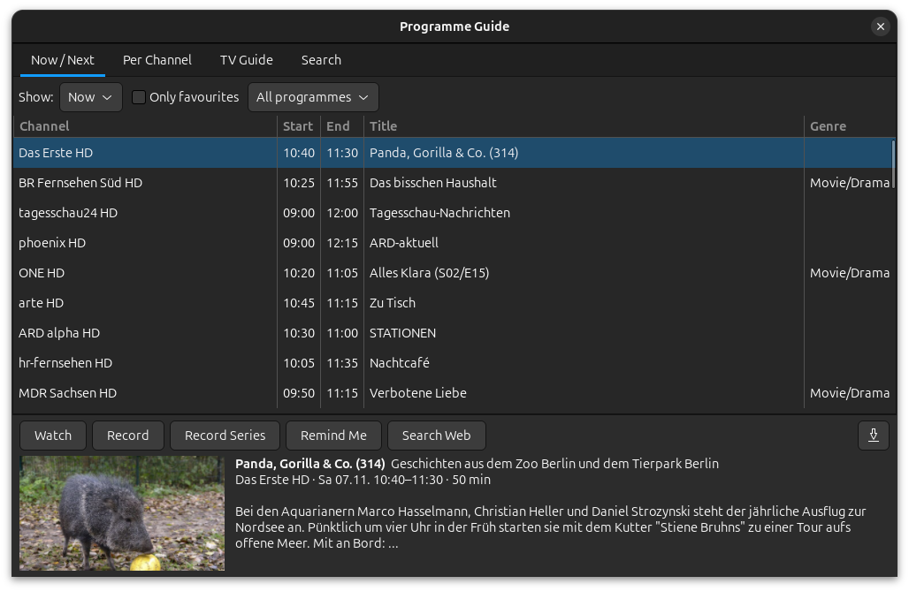
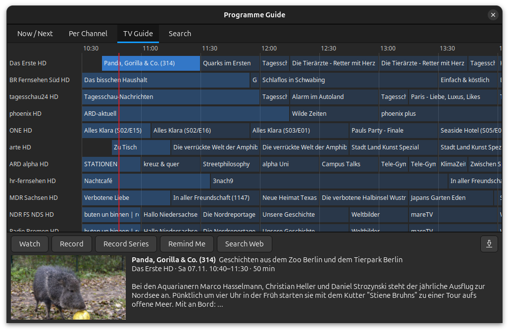
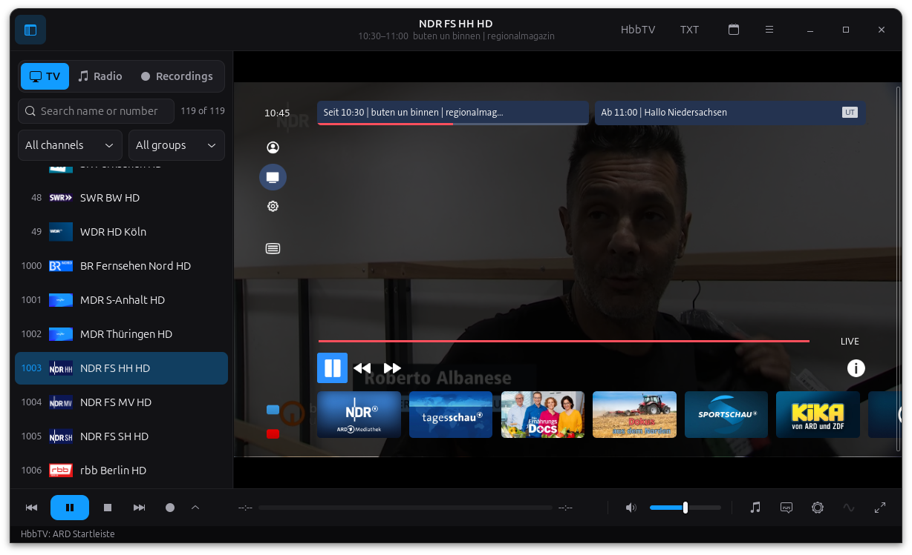
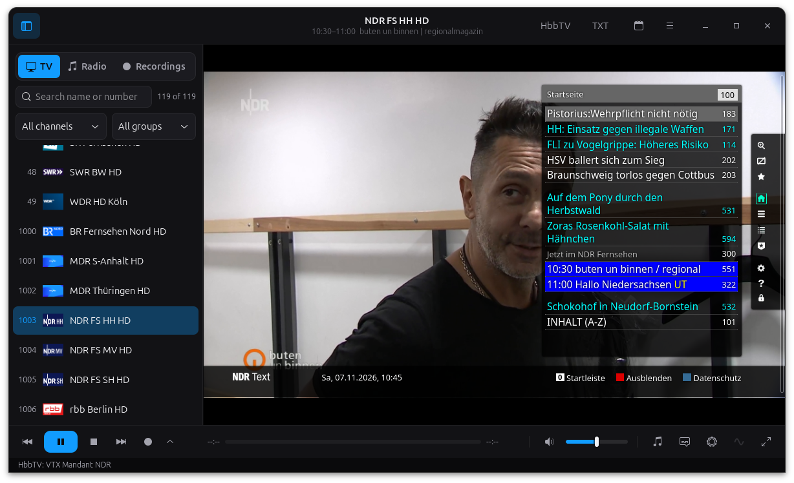
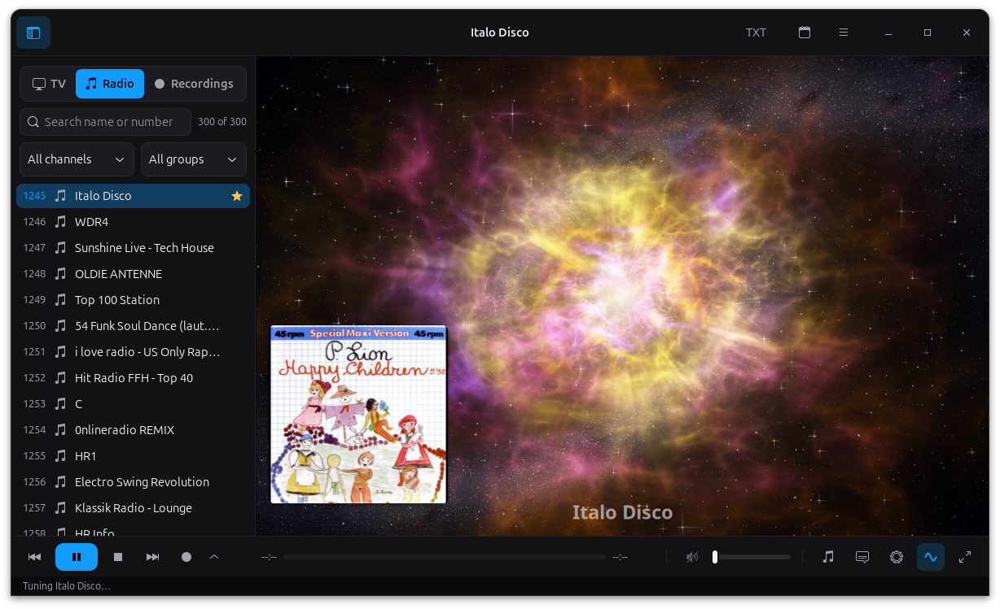
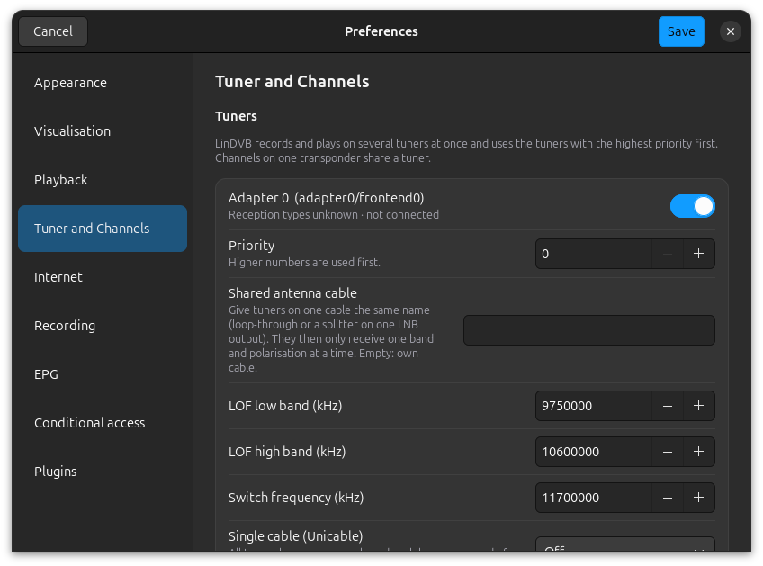

<p align="center">
  
</p>

<h1 align="center">LinDVB</h1>

**Digital TV and Radio App for the GNOME desktop.**

LinDVB watches and records TV and radio from satellite, cable and terrestrial tuners,
from internet streams (IPTV, HLS, DASH, multicast, DVB-I) and from files. It is a GTK 4
application written in Python on top of the standard Linux media stack:

* **Linux DVB API v5** for tuning (DVB-S/S2, DVB-C, DVB-T/T2, ATSC, ISDB-T, DTMB),
  through GStreamer's `dvbsrc`, or driven directly for single-cable (Unicable / JESS) tuners
* **libdvbv5** (`dvbv5-scan` from v4l-utils) for channel search
* **GStreamer** for playback, recording and remuxing, `GstMpegts` for the programme guide
  and `teletextdec` (libzvbi) for teletext

[docs/FEATURES.md](docs/FEATURES.md) lists the features and whether LinDVB has
them.


| **Timeshift** | **File playback** |
|  |  |
| **Programme guide** | **TV guide timeline** |
|  |  |
| **Timer recordings** | **Channel search** |
|  |  |
| **HbbTV** | **Teletext** |
|  |  |
| **Radio** | **Preferences** |
|  |  |

## Features

### Watching and listening

* Separate TV and radio: a TV/Radio switch (Ctrl+M) above the channel list, which
  shows one kind at a time; favourites mix both. LinDVB remembers the last channel
  of each kind and tunes the last one again at start
* Channel list with search, favourites/FTA/encrypted/HD/internet filters and
  groups; channel number entry, last channel, channel and favourite zapping
* Live TV and radio from DVB tuners and internet streams (HLS, DASH, HTTP, RTSP,
  RTP/UDP multicast including source-specific `rtp://source@group:port`)
* Timeshift: pause live TV, jump ±10 s / ±60 s, back to live, keep the buffer
* Audio track and subtitle selection, 10-band equalizer, brightness/contrast/
  saturation/hue, deinterlacing, zoom modes, window size presets, screenshots,
  play rate for files, playlists, sleep timer
* Hardware video decoding on the graphics card (Preferences ▸ Playback ▸ Video
  decoding): automatic VA-API (Intel, AMD), NVDEC (NVIDIA) or V4L2 (ARM boards)
  with a fallback to the next decoder and finally software when a driver fails;
  Vulkan Video or software can be chosen by hand. With VA-API, deinterlacing
  runs on the graphics card too
* Subtitles: DVB subtitles and teletext subtitles (pages from the channel's PMT,
  e.g. 150 or 777) drawn over the video in sync; closed captions (CEA-608/708) for
  ATSC and US cable channels (Subtitles ▸ Closed Captions)
* Teletext window with page navigation, find, copy and save, opened from the "TXT"
  button in the header bar (greyed out when the channel carries no teletext)
* Picture in picture and a channel mosaic (nine channels at once) for internet channels
* Radio visualisations, drawn on the graphics card (OpenGL) at full resolution:
  glow waves, nebula particles, light ribbons (threads of light over a
  rippling water reflection), pulsar (a core bursting into spectrum-shaped
  colour flames with spokes, orbits and star dust), supernova (a white-hot core
  in a shell of glowing filaments), occasus solis (a sunset with rays between
  drifting clouds), aurora borealis (northern lights over snowy mountains) and Goom HD (the original GOOM logic, drawn by
  shaders natively up to 4K), LED spectrum analyser, VU meters and oscilloscope (classic),
  and projectM (MilkDrop presets) or the original GOOM through the bundled
  GStreamer add-on; plugins can add their own.
  A button at the bottom right of the control bar picks the visualisation; it
  is only active while radio or audio plays
* Now playing over the radio visualisation, each part switchable in
  Preferences › Visualisation: station logo tile, album cover, artist / album and
  year / track and title, and a clock. Song details come from the RDS RadioText of
  DVB radio, the ICY stream title of internet radio and the tags of audio files;
  covers from the file or the iTunes Search API, logos from a logo folder

### Recording

* Recording: instant, timer (lead/follow-up time, weekday repeat, record or tune,
  after-recording standby/hibernate/power off/quit), from the EPG, and series rules by title
* Recording formats: TS, MPG, MP4 or MKV for TV and native MP2/MP3/AAC/AC3 for radio,
  with teletext, subtitles and EPG data; audio tracks: all, preferred language only or
  the first (MP4 keeps one). Defaults in Preferences > Recording, changeable per timer
  and with "Record with Options…" for one instant recording; file naming scheme with
  placeholders (%date %time %station %name ...) and sub-folders
* Recordings tab: a library of the recordings with preview picture, programme title,
  subheading, channel, date, length and description (saved beside each recording as
  `<name>.lindvb.json`), sorting, search, and "continue watching": a recording starts
  where you stopped it, with a bar showing how much you have seen
* Recording and device statistics (lock, signal, SNR, BER, bitrate)

### Programme guide

* Programme guide: now/next and prime time, per channel, timeline grid, search,
  web search links; on-screen now/next display; XMLTV for internet channels
  with automatic and manual matching of M3U channels to guide channels;
  MediaHighway 1/2 and Freesat EPG; preferred EPG language and time zone
* Reminders: "Remind Me" in the programme guide sends a desktop notification a few
  minutes before the programme starts (with a button to switch to the channel)
* Export the programme guide as XMLTV for other programs

### Reception and tuners

* Several tuners at once: every tuner with its reception types, on/off and priority;
  a channel goes to a tuner that can receive it, channels of one transponder share a
  tuner, tuners on one antenna cable (loop-through) keep to one band and
  polarisation, and each tuner can have an LNB of its own
* Single cable: Unicable I (EN 50494) and Unicable II / JESS (EN 50607) with a user
  band per tuner, optional PIN and templates of common devices
* Channel search with dvbv5-scan (DiSEqC 1.0 ports, LNB types, NIT search), and
  LinDVB's own search on single-cable tuners
* ATSC (USA, Canada, Mexico, South Korea): virtual channel numbers like 7.1 in the
  channel list (searchable as "7.1" or "7-1") and the programme guide from PSIP
  (channel table, EIT and extended texts, GPS time)
* Channel analysis (right click on a channel ▸ Channel Analysis…, or the main menu ▸ Channel
  Analysis…): a window of its own with seven pages. Overview: signal ring, level,
  C/N and the margin in dB to what the modulation needs, the bit rate of video,
  audio and data as a running stacked curve, formats, now/next, encryption and
  stream health. Signal: C/N, level and BER curves, an error timeline, the tuned
  parameters from the frontend, a dish alignment aid (full screen figure with a
  tone that rises with the signal), a reception log and on-screen warnings when the
  margin gets thin. Transport stream: every PID with content, format, bit rate,
  continuity errors and a sparkline, PCR interval and jitter, and the occupancy of
  the whole transponder. Video & audio: codec, profile, scan, AFD, black bars,
  3:2 pulldown, HDR, I/P/B frame sizes and GOP, audio tracks with nominal and
  measured rate and dialnorm, EBU R 128 loudness with jumps. Tables & EPG: every SI
  table with version and repetition, a decoded tree and hex view, the clock offset
  of the channel. Encryption and HbbTV: CA systems, ECM/EMM, crypto period, AIT
  applications and carousels. Internet channels show server, HTTP status, response
  time, HLS/DASH variants, segments, buffer and rebuffering instead. Measures on a
  free second tuner in the background, can follow the channel on screen, compares
  two channels side by side and exports text, JSON, CSV, a picture of the window or
  30 s of the stream
* Channel editor and favourites
* Import: dvbv5 channel files, VDR `channels.conf`, Enigma2 `lamedb`, M3U, CSV and
  `*.ini` channel lists; IPTV playlists also from a web address
  (Preferences ▸ Internet ▸ IPTV). Export: dvbv5, M3U, CSV
* Conditional access for your own encrypted channels: an external softcam
  (DVBAPI/OSCam, descrambled in software with libdvbcsa) or a hardware CI/CI+
  module supplies the control words from your subscription card; CAM menu for
  CI modules (smart card info, parental control, PIN prompts)

### Internet and interactive TV

* DVB-I (Preferences ▸ Internet): the channel list of your region from the German
  service list registry, with postcode, channel numbers (LCN), logos and a daily
  update; each channel uses your antenna/cable/satellite channel where the
  channel search found it and the internet stream otherwise ([docs/DVB-I.md](docs/DVB-I.md))
* HbbTV 2.0.4 (red button, F5): the channels' interactive services in a transparent
  WebKitGTK view over the picture: media libraries (MPEG-DASH with subtitles),
  applications from the broadcast (object carousel), stream events, digital teletext,
  youth protection with PIN, companion screens and media synchronisation
  ([docs/HBBTV.md](docs/HBBTV.md))

### Integration

* Media keys and the GNOME media controls (MPRIS): play/pause, stop, next/previous
  channel, with channel, programme and logo shown
* Script hooks: your own programs in `~/.config/lindvb/hooks/` run on channel change,
  recording start/stop and reminders (environment variables `LINDVB_CHANNEL`,
  `LINDVB_TITLE`, `LINDVB_FILE`, ...)
* Plugins: Python add-ons for channel-list importers, conditional-access
  providers, radio visualisations, life-cycle hooks and menu entries

## Plugins and conditional access

LinDVB can load plugins and can descramble the encrypted channels you are
entitled to with **your own** subscription card. It contains no decryption keys
and breaks no encryption: it talks to a conditional-access client you run
yourself (a softcam such as OSCam reading your card, or a hardware CI module),
the same way tvheadend, VDR and enigma2 do, and applies the control words that
client returns. See [docs/PLUGINS.md](docs/PLUGINS.md) for how to write a plugin
and how to point LinDVB at your softcam or CI module, and
[docs/SOFTCAM.md](docs/SOFTCAM.md) for a step-by-step OSCam setup.

## Install

### AppImage

Download `LinDVB-…-x86_64.AppImage` from the
[releases](https://github.com/thommy87/LinDVB/releases) (or the latest
[Build AppImage](https://github.com/thommy87/LinDVB/actions/workflows/appimage.yml) run),
then:

```sh
chmod +x LinDVB-*-x86_64.AppImage
./LinDVB-*-x86_64.AppImage
```

The AppImage bundles Python, GTK 4, GStreamer (with FFmpeg decoders) and the dvbv5
tools. It is built on Ubuntu 24.04 and needs glibc 2.39 or newer (Ubuntu 24.04,
Debian 13, Fedora 40 and later). To build it yourself: `packaging/build-appimage.sh`.

### Flatpak

Download `LinDVB-…-x86_64.flatpak` from the
[releases](https://github.com/thommy87/LinDVB/releases), then:

```sh
flatpak install --user LinDVB-*-x86_64.flatpak     # pulls the GNOME 48 runtime from Flathub
flatpak run io.github.thommy87.LinDVB
```

The Flatpak has access to all devices (for `/dev/dvb`), the network, and your Videos
and Pictures folders. To build it yourself:
`flatpak-builder --user --install build-flatpak flatpak/io.github.thommy87.LinDVB.yml`.

### Snap

Download `lindvb_…_amd64.snap` from the [releases](https://github.com/thommy87/LinDVB/releases), then:

```sh
sudo snap install --dangerous ./lindvb_*_amd64.snap
sudo snap connect lindvb:dvb          # access to /dev/dvb tuners
sudo snap connect lindvb:shutdown     # optional: standby/power off after recordings
lindvb
```

The snap is not signed by the Snap Store, so double-clicking it in the software centre fails
with "cannot find signatures with metadata for snap"; install it with `--dangerous` as above.
To build it yourself: `snapcraft` in the source tree.

### Debian package (Ubuntu 24.04 LTS and newer, Debian 13)

Download `lindvb_…_all.deb` from the [releases](https://github.com/thommy87/LinDVB/releases), then:

```sh
sudo apt install ./lindvb_*_all.deb
```

apt pulls in GTK 4, GStreamer and PyGObject from your distribution. Optional extras
(HbbTV via `gir1.2-webkit-6.0`, faster video output via `gstreamer1.0-gtk4`) are
recommended packages, so apt installs them when they are available. To build it
yourself: `packaging/build-deb.sh`.

### From source

Debian / Ubuntu:

```sh
sudo apt install python3-gi python3-gi-cairo gir1.2-gtk-4.0 gir1.2-gstreamer-1.0 \
  gir1.2-gst-plugins-base-1.0 gir1.2-gst-plugins-bad-1.0 \
  gstreamer1.0-plugins-base gstreamer1.0-plugins-good gstreamer1.0-plugins-bad \
  gstreamer1.0-libav dvb-tools dtv-scan-tables
# optional, faster video output:
sudo apt install gstreamer1.0-gtk4
# optional, HbbTV (red button):
sudo apt install gir1.2-webkit-6.0
```

Fedora:

```sh
sudo dnf install python3-gobject gtk4 gstreamer1-plugins-base gstreamer1-plugins-good \
  gstreamer1-plugins-bad-free gstreamer1-plugins-bad-free-extras gstreamer1-plugin-libav \
  gstreamer1-plugin-gtk4 v4l-utils dtv-scan-tables
```

Arch: `gtk4 python-gobject gst-plugins-good gst-plugins-bad gst-libav gst-plugin-gtk4 v4l-utils dtv-scan-tables`

Then run from the source tree, or install it. The source package `lindvb-…tar.gz` on the
[releases](https://github.com/thommy87/LinDVB/releases) page is a Python sdist with the
icons, translations and desktop files, for `pip install` or distribution packaging:

```sh
python3 -m lindvb
# or
pip install --user .   &&   lindvb    # PyGObject comes from the distro packages above
```

Your user needs access to `/dev/dvb` (usually the `video` group).

## First steps

1. **Preferences → Tuner and Channels → Channel Search** (Shift+Ctrl+S): pick your tuner, a transponder list (from
   dtv-scan-tables, or add a folder with `.ini` transponder lists), LNB and
   DiSEqC port, then start. Or **Menu → Import Channel List** to load an existing list.
2. Several tuners: **Preferences → Tuner and Channels → Tuners** lists every tuner found,
   with its reception types. Switch tuners on or off, set a priority, give tuners on one
   antenna cable (loop-through, splitter) the same cable name, and set an LNB per tuner.
   For a single-cable system (Unicable I / EN 50494, Unicable II / JESS / EN 50607) set
   the type, user band and its frequency per tuner; the channel search works on it too.
   LinDVB picks a tuner that can receive the channel, lets channels of one transponder
   share a tuner, and takes the live tuner only for a recording.
3. Double-click a channel to watch it. Press Space to pause (timeshift), ←/→ to jump.
4. Set timers in **Programme Guide** (Record / Record Series) or **Timer Recordings**.

Command line: `lindvb [-i LIST …] [-c CHANNEL] [FILE|URL …]`

## Keys

| Key | Action | Key | Action |
|---|---|---|---|
| Space | Pause / timeshift | ← / → | Jump −10 / +10 s |
| L | Back to live | ↑ ↓, Page Up/Down | Channel minus / plus |
| 0–9 | Channel number | Backspace | Last channel |
| + / − | Volume | M | Mute |
| F, F11 | Full screen | F9 | Show/hide channel list |
| E, Ctrl+E | Programme guide | R, Ctrl+R | Record |
| T | Teletext | S | Screenshot |
| I, O | On-screen info | N / P | Playlist next / previous |
| Ctrl+T | Timers | Ctrl+O / Ctrl+U | Open file / URL |

IR remotes supported by the kernel (rc-core) send ordinary key events, so they work
with these keys; use `ir-keytable` to remap buttons.

## Settings and files

* `~/.config/lindvb/settings.json`, `channels.json`, `timers.json`
* `~/.cache/lindvb/epg.json` and the timeshift buffer (`timeshift/`)
* `~/.local/share/lindvb/reception/` the reception log of the channel analysis (one
  CSV file a day, kept 31 days; off unless switched on)
* Recordings go to `~/Videos/LinDVB` as `.ts` by default (naming scheme with
  `%year %date %time %station %event`)

## Releasing

Run the **Release** workflow from the Actions tab and enter a tag such as `v0.9.0`. It
builds the AppImage, Flatpak, Snap, Ubuntu `.deb` and Python source package (sdist) and
publishes them in one GitHub release. Pushes and pull requests build only the AppImage; the
other packages are built only for releases (or by starting their workflows by hand).

## Development

```sh
python3 -m pytest tests        # format parsers, EPG, scheduler helpers
LINDVB_TEST_TS=sample.ts python3 -m lindvb   # replay a TS file instead of a tuner
```

`LINDVB_TEST_TS` makes every DVB channel play the given transport stream at real
time, which lets you test timeshift, recording, EPG and teletext without hardware.

The kernel's virtual DVB tuner **vidtv** (`sudo modprobe vidtv`) tests channel
search, tuning and the EPG like a real tuner; LinDVB ships scan files for it.
See [docs/TESTING.md](docs/TESTING.md).

## Logo

The app icon is `data/lindvb.svg`, with PNG sizes from 16 to 512 pixels in
`data/icons/hicolor`. The original artwork is in `data/logo`: `lindvb-logo.png` in
colour and `lindvb-logo-mono.png` / `lindvb-logo-mono.svg` in black and white for
print or single-colour uses.

## Not yet implemented

* Picture in picture and mosaic for DVB channels (internet channels work)
* CI+ host authentication
* DiSEqC motors (positioners)
* Streaming to other devices (media server, UPnP, RTSP, SAT>IP)
* Audio passthrough (AC-3/DTS to an AV receiver)
* OSD skins

See [docs/FEATURES.md](docs/FEATURES.md).

## If LinDVB stops responding

When the main loop does not answer for 8 seconds, LinDVB writes the stacks of
all its threads to `~/.cache/lindvb/hang.log` (crashes go there too). Please
attach that file when you report a freeze.

## License

Copyright (C) 2026 thommy87.

LinDVB is free software under the GNU General Public License version 2 or (at your
option) any later version. See [LICENSE](LICENSE).

LinDVB contains code from other free software projects, each under a licence
compatible with this one:

* the MediaHighway and Freesat EPG (`lindvb/epgsources.py`, `lindvb/freesat_tables.py`)
  follows the VDR EEPG plugin by Dingo35 and Dimitar Petrovski, based on mhwepg by
  Jean-Claude Repetto and the Freesat patch by dom (GNU GPL 2 or later)
* `lindvb/goom.py` is a port of GOOM 2k4 (Copyright (C) 2000-2004 Jean-Christophe
  Hoelt and the GOOM authors, from gst-plugins-good, GNU LGPL 2.1 or later)
* `lindvb/vendor` holds dash.js by the DASH Industry Forum (BSD 3-Clause)

[THIRD-PARTY-NOTICES.md](THIRD-PARTY-NOTICES.md) lists these and the libraries,
presets and icons LinDVB uses or ships, with their licences. The About dialog
(☰ → About LinDVB) shows the credits too.
