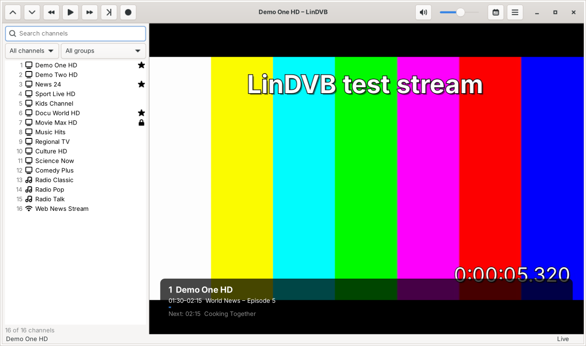
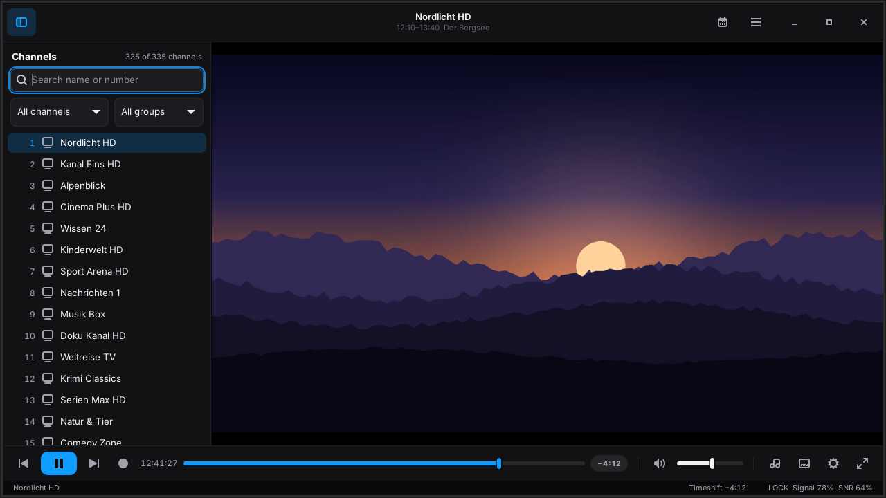
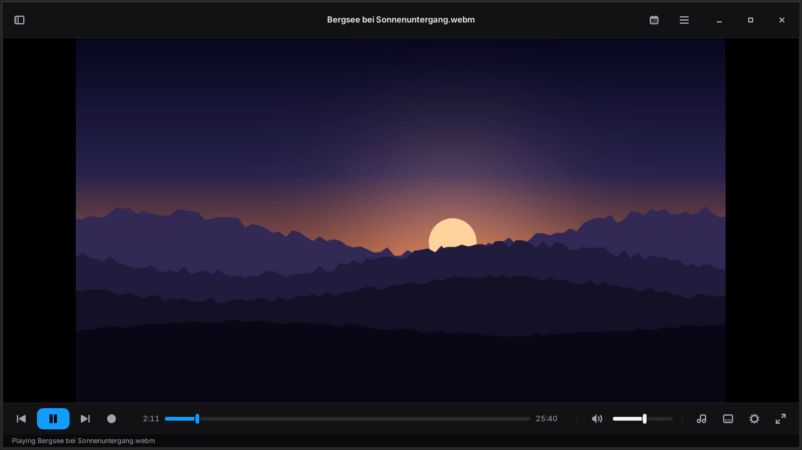
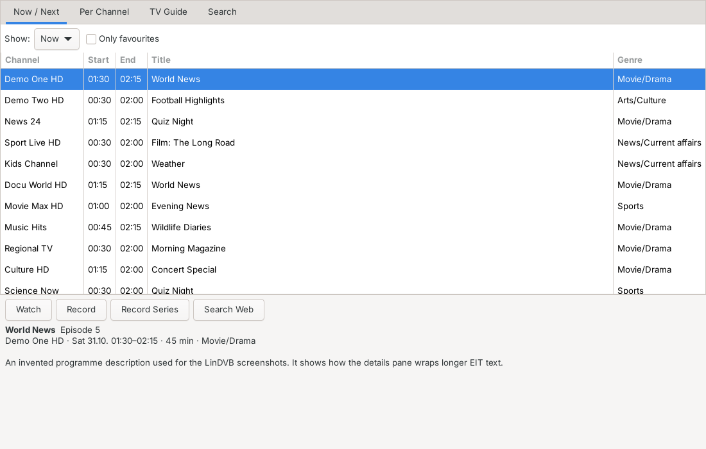
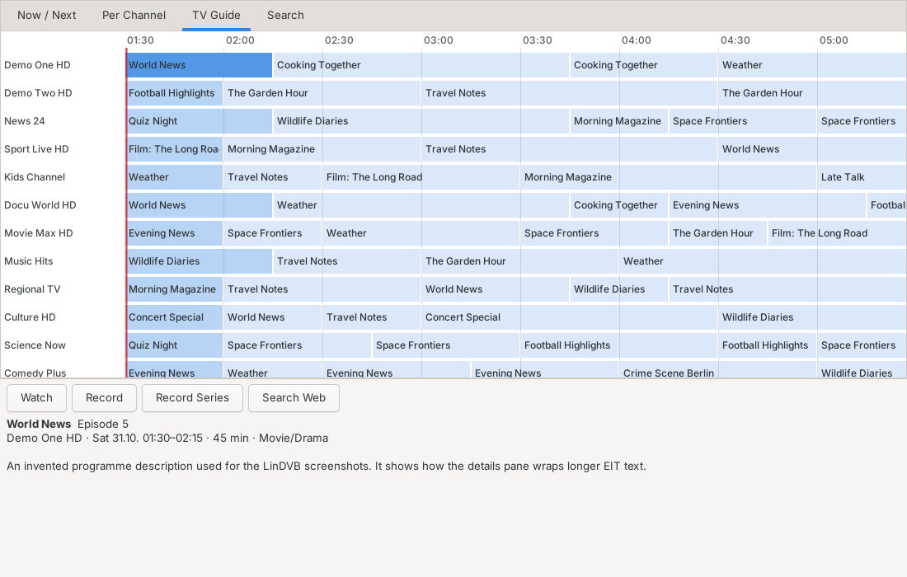
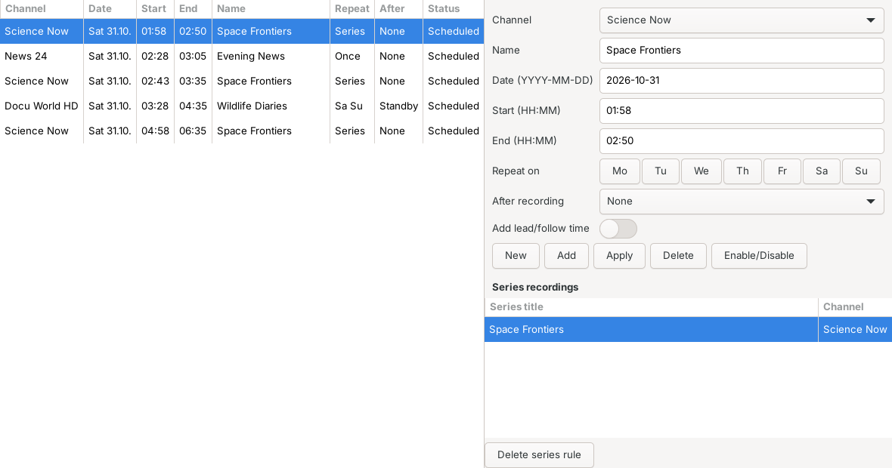
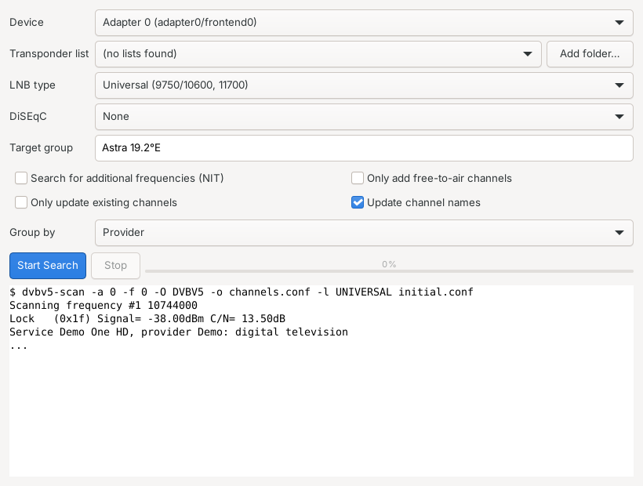

# LinDVB

DVB Stream Viewer App for Gnome Desktop.

LinDVB watches and records satellite, cable, terrestrial and internet TV on Linux.
It is a GTK 4 application written in Python that uses the standard Linux DVB stack:

* **Linux DVB API v5** through GStreamer's `dvbsrc` for tuning (DVB-S/S2, DVB-C,
  DVB-T/T2, ATSC, ISDB-T, DTMB)
* **libdvbv5** (`dvbv5-scan` from v4l-utils) for channel search
* **GStreamer** `playbin` for decoding, `tsparse`/`tsdemux`, `GstMpegts` for the EPG and
  `teletextdec` (libzvbi) for teletext

The feature set follows DVBViewer on Windows. [docs/FEATURES.md](docs/FEATURES.md)
lists each DVBViewer function, the evidence for it from a DVBViewer installation,
and whether LinDVB has it.



The player uses a minimal dark look with a blue accent: the picture fills the
window, and one slim control bar holds previous/next, play/pause, record, the seek
bar (file position, or the timeshift buffer with a LIVE button for TV), volume,
audio track, subtitles and a settings menu. In full screen the bar floats over the
picture and hides itself when the mouse is still.

| Timeshift | File playback |
|---|---|
|  |  |
| **Programme guide** | **TV guide timeline** |
|  |  |
| **Timer recordings** | **Channel search** |
|  |  |

(Screenshots use invented channels and programmes and a generated test stream.)

## Features

* Separate TV and radio: a TV/Radio switch (Ctrl+M) above the channel list, which
  shows one kind at a time; favourites mix both. LinDVB remembers the last channel
  of each kind and tunes the last one again at start
* Channel list with search, favourites/FTA/encrypted/HD/internet filters and
  groups; channel number entry, last channel, channel and favourite zapping
* Radio visualisations, drawn on the graphics card (OpenGL) at full resolution:
  glow waves, nebula particles and Goom HD (the original GOOM logic, drawn by
  shaders natively up to 4K), LED spectrum analyser, VU meters and oscilloscope (classic),
  and projectM (MilkDrop presets) or the original GOOM through the bundled
  GStreamer add-on; plugins can add their own.
  A button at the bottom right of the control bar picks the visualisation; it
  is only active while radio or audio plays
* Live TV and radio from DVB tuners and internet streams (HLS, DASH, HTTP, RTSP,
  RTP/UDP multicast including source-specific `rtp://source@group:port`)
* Now playing over the radio visualisation, each part switchable in
  Preferences › Visualisation: station logo tile, album cover, artist / album and
  year / track and title, and a clock. Song details come from the RDS RadioText of
  DVB radio, the ICY stream title of internet radio and the tags of audio files;
  covers from the file or the iTunes Search API, logos from a logo folder
* Timeshift: pause live TV, jump ±10 s / ±60 s, back to live, keep the buffer
* Recording: instant, timer (lead/follow-up time, weekday repeat, record or tune,
  after-recording standby/hibernate/power off/quit), from the EPG, and series rules by title
* Recording formats: TS, MPG, MP4 or MKV for TV and native MP2/MP3/AAC/AC3 for radio,
  with teletext, subtitles and EPG data; audio tracks: all, preferred language only or
  the first (MP4 keeps one). Defaults in Preferences > Recording, changeable per timer
  and with "Record with Options…" for one instant recording; file naming scheme with
  placeholders (%date %time %station %name ...) and sub-folders
* Programme guide: now/next and prime time, per channel, timeline grid, search,
  web search links; on-screen now/next display; XMLTV for internet channels
  with automatic and manual matching of M3U channels to guide channels;
  MediaHighway 1/2 and Freesat EPG; preferred EPG language and time zone
* Teletext window with page navigation, find, copy and save
* Subtitles: DVB subtitles and teletext subtitles (pages from the channel's PMT,
  e.g. 150 or 777) drawn over the video in sync
* Channel search with dvbv5-scan, DiSEqC 1.0 ports, LNB types, NIT search
* Channel editor and favourites
* Import: dvbv5 channel files, VDR `channels.conf`, Enigma2 `lamedb`, M3U, CSV and
  DVBViewer channel lists (`*.ini`). Export: dvbv5, M3U, CSV
* Audio track and subtitle selection, 10-band equalizer, brightness/contrast/
  saturation/hue, deinterlacing, zoom modes, window size presets, screenshots,
  play rate for files, playlists, sleep timer
* Recording and device statistics (lock, signal, SNR, BER, bitrate)
* Plugins: Python add-ons for channel-list importers, conditional-access
  providers, radio visualisations, life-cycle hooks and menu entries
* Conditional access for your own encrypted channels: an external softcam
  (DVBAPI/OSCam, descrambled in software with libdvbcsa) or a hardware CI/CI+
  module supplies the control words from your subscription card; CAM menu for
  CI modules (smart card info, parental control, PIN prompts)

## Plugins and conditional access

LinDVB can load plugins and can descramble the encrypted channels you are
entitled to with **your own** subscription card. It contains no decryption keys
and breaks no encryption: it talks to a conditional-access client you run
yourself (a softcam such as OSCam reading your card, or a hardware CI module),
the same way tvheadend, VDR and enigma2 do, and applies the control words that
client returns. See [docs/PLUGINS.md](docs/PLUGINS.md) for how to write a plugin
and how to point LinDVB at your softcam or CI module.

## Install

### AppImage

Download `LinDVB-…-x86_64.AppImage` from the
[releases](https://github.com/thommy87/LinDVB/releases) (or the latest
[Build AppImage](https://github.com/thommy87/LinDVB/actions/workflows/appimage.yml) run),
then:

```sh
chmod +x LinDVB-*-x86_64.AppImage
./LinDVB-*-x86_64.AppImage
```

The AppImage bundles Python, GTK 4, GStreamer (with FFmpeg decoders) and the dvbv5
tools. It is built on Ubuntu 24.04 and needs glibc 2.39 or newer (Ubuntu 24.04,
Debian 13, Fedora 40 and later). To build it yourself: `packaging/build-appimage.sh`.

### Flatpak

Download `LinDVB-…-x86_64.flatpak` from the
[releases](https://github.com/thommy87/LinDVB/releases) (or the latest
[Build Flatpak](https://github.com/thommy87/LinDVB/actions/workflows/flatpak.yml) run), then:

```sh
flatpak install --user LinDVB-*-x86_64.flatpak     # pulls the GNOME 48 runtime from Flathub
flatpak run io.github.thommy87.LinDVB
```

The Flatpak has access to all devices (for `/dev/dvb`), the network, and your Videos
and Pictures folders. To build it yourself:
`flatpak-builder --user --install build-flatpak flatpak/io.github.thommy87.LinDVB.yml`.

### Snap

Download `lindvb_…_amd64.snap` from the [releases](https://github.com/thommy87/LinDVB/releases), then:

```sh
sudo snap install --dangerous ./lindvb_*_amd64.snap
sudo snap connect lindvb:dvb          # access to /dev/dvb tuners
sudo snap connect lindvb:shutdown     # optional: standby/power off after recordings
lindvb
```

The snap is not signed by the Snap Store, so double-clicking it in the software centre fails
with "cannot find signatures with metadata for snap"; install it with `--dangerous` as above.
To build it yourself: `snapcraft` in the source tree.

### From source

Debian / Ubuntu:

```sh
sudo apt install python3-gi python3-gi-cairo gir1.2-gtk-4.0 gir1.2-gstreamer-1.0 \
  gir1.2-gst-plugins-base-1.0 gir1.2-gst-plugins-bad-1.0 \
  gstreamer1.0-plugins-base gstreamer1.0-plugins-good gstreamer1.0-plugins-bad \
  gstreamer1.0-libav dvb-tools dtv-scan-tables
# optional, faster video output:
sudo apt install gstreamer1.0-gtk4
```

Fedora:

```sh
sudo dnf install python3-gobject gtk4 gstreamer1-plugins-base gstreamer1-plugins-good \
  gstreamer1-plugins-bad-free gstreamer1-plugins-bad-free-extras gstreamer1-plugin-libav \
  gstreamer1-plugin-gtk4 v4l-utils dtv-scan-tables
```

Arch: `gtk4 python-gobject gst-plugins-good gst-plugins-bad gst-libav gst-plugin-gtk4 v4l-utils dtv-scan-tables`

Then run from the source tree, or install it:

```sh
python3 -m lindvb
# or
pip install --user .   &&   lindvb    # PyGObject comes from the distro packages above
```

Your user needs access to `/dev/dvb` (usually the `video` group).

## First steps

1. **Menu → Channel Search**: pick your tuner, a transponder list (from
   dtv-scan-tables, or add a folder with DVBViewer-style transponder lists), LNB and
   DiSEqC port, then start. Or **Menu → Import Channel List** to load an existing list.
2. Double-click a channel to watch it. Press Space to pause (timeshift), ←/→ to jump.
3. Set timers in **Programme Guide** (Record / Record Series) or **Timer Recordings**.

Command line: `lindvb [-i LIST …] [-c CHANNEL] [FILE|URL …]`

## Keys

| Key | Action | Key | Action |
|---|---|---|---|
| Space | Pause / timeshift | ← / → | Jump −10 / +10 s |
| L | Back to live | ↑ ↓, Page Up/Down | Channel minus / plus |
| 0–9 | Channel number | Backspace | Last channel |
| + / − | Volume | M | Mute |
| F, F11 | Full screen | F9 | Show/hide channel list |
| E, Ctrl+E | Programme guide | R, Ctrl+R | Record |
| T | Teletext | S | Screenshot |
| I, O | On-screen info | N / P | Playlist next / previous |
| Ctrl+T | Timers | Ctrl+O / Ctrl+U | Open file / URL |

IR remotes supported by the kernel (rc-core) send ordinary key events, so they work
with these keys; use `ir-keytable` to remap buttons.

## Settings and files

* `~/.config/lindvb/settings.json`, `channels.json`, `timers.json`
* `~/.cache/lindvb/epg.json` and the timeshift buffer (`timeshift/`)
* Recordings go to `~/Videos/LinDVB` as `.ts` by default (naming scheme with
  `%year %date %time %station %event`)

## Releasing

Run the **Release** workflow from the Actions tab and enter a tag such as `v0.1.1`. It
builds the AppImage, Flatpak and Snap and publishes all three in one GitHub release.

## Development

```sh
python3 -m pytest tests        # format parsers, EPG, scheduler helpers
LINDVB_TEST_TS=sample.ts python3 -m lindvb   # replay a TS file instead of a tuner
```

`LINDVB_TEST_TS` makes every DVB channel play the given transport stream at real
time, which lets you test timeshift, recording, EPG and teletext without hardware.

## Not yet implemented

Picture in picture and mosaic, CI+ host authentication, Unicable and DiSEqC motors, HbbTV, media server/UPnP/RTSP server, OSD skins, translations. See
[docs/FEATURES.md](docs/FEATURES.md).

## If LinDVB stops responding

When the main loop does not answer for 8 seconds, LinDVB writes the stacks of
all its threads to `~/.cache/lindvb/hang.log` (crashes go there too). Please
attach that file when you report a freeze.

## License

LinDVB is free software under the GNU General Public License version 2 or (at your
option) any later version. See [LICENSE](LICENSE).

`lindvb/goom.py` is a port of GOOM 2k4 (Copyright (C) 2000-2004 Jean-Christophe
Hoelt and the GOOM authors, from gst-plugins-good, GNU LGPL 2.1 or later).
